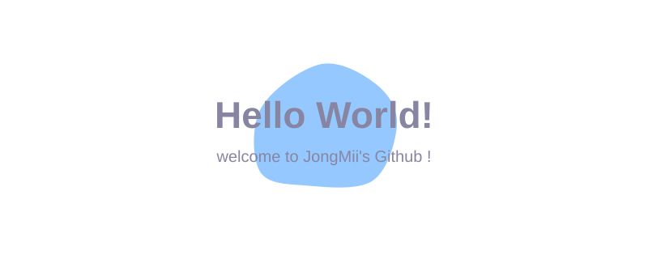
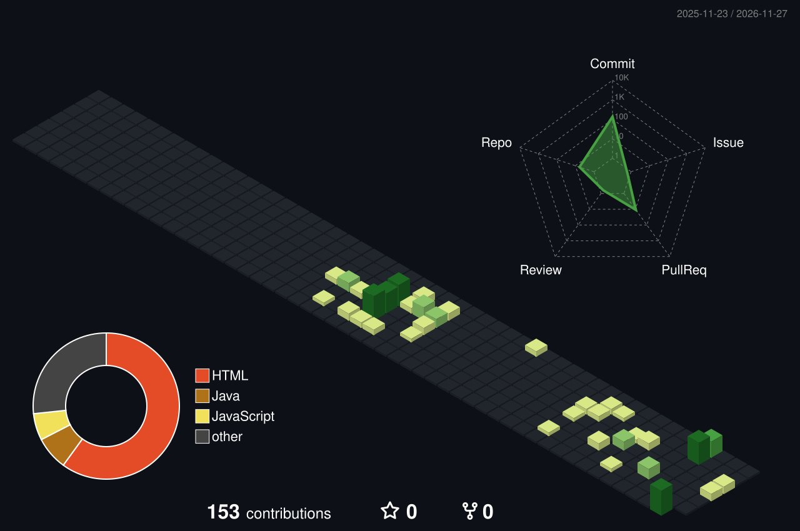

 

  

## 👨‍💻 About Me

- 🎓 소프트웨어 전공, 2027년 2월 졸업 예정
- 🛠️ Spring Boot 기반 웹 프로젝트의 기능 구현 경험
- ⚛️ React 프로젝트에 참여하며 프론트엔드 구조와 스타일링 학습
- 📚 프로젝트를 통해 새로운 기술을 익히고 개발 경험을 쌓는 중입니다.

---

## 🛠️ Tech Stack

| Category | Technologies |
|:--|:--|
| **Languages** |    |
| **Frontend** |       |
| **Backend** |    |
| **Database** |   |
| **Tools** |         |

---

## 📌 Projects

### 🍔 [BRORDER — 배달 주문 웹 프로젝트](https://github.com/Munjunyeong/Brorder)

학교 프로젝트로 진행한 배달 주문 중심의 웹 서비스.

- **주요 기술:** Java, Spring Boot, MyBatis, MariaDB
- **주요 경험:** 리뷰 작성·조회·수정·삭제 기능 구현
- **추가 경험:** 데이터베이스 연동, 페이지 간 데이터 전달, Git 브랜치 병합 및 협업

### 🌱 [쓰담쓰담 (ss-dam) — React 웹 프로젝트](https://github.com/yeon7513/ss-dam)

타 팀의 기존 프로젝트의 화면 구현에 참여하며 React와 SCSS 기반 구조를 익힘.

- **주요 기술:** React, JavaScript, SCSS
- **주요 경험:** 마이페이지 사이드바 등 화면 구조 및 스타일 작업
- **배운 점:** 컴포넌트 구조, 기존 스타일 재사용, 프론트엔드와 백엔드의 연결 구조 이해

### 🎵 [제리에의 정원 — 픽셀 아트 기반 음악 플랫폼](https://github.com/skyhighj/garden-of-serie)

음악 감상을 중심으로 3D 도트 스타일의 공간을 꾸미고 즐길 수 있는 웹 플랫폼. 집과 정원을 자유롭게 꾸미고, 공간 속에서 음악을 감상하는 경험을 제공하는 것을 목표로 현재 개발 진행중

- **주요 기술:** TypeScript, Phaser, React, Zustand, Tiled
- **주요 기능:** 음악 재생 및 관리, 픽셀 공간 구성, 집과 정원 꾸미기, 오브젝트 상호작용
- **개발 방향:** 음악 플랫폼과 인터랙티브한 픽셀 월드를 결합한 사용자 경험 구현
- **설계 목표:** 게임 엔진과 웹 서비스 기능을 분리하여 다양한 웹 서비스에 적용할 수 있는 재사용 가능한 구조 설계
- 
---

  

  방문해 주셔서 감사합니다! 

