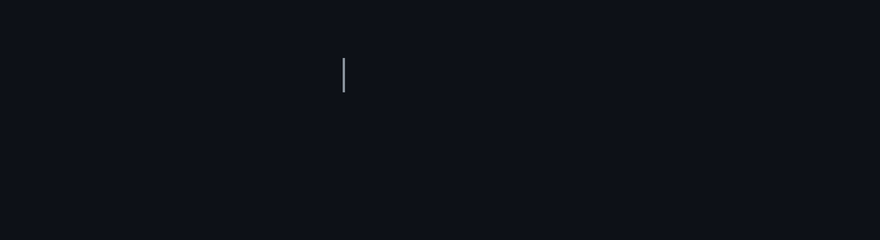

 

  

<h3 align="center">안녕하세요, 웹개발자 박종민입니다 </h3>

  웹 개발을 공부하며 직접 기능을 구현하고, 프로젝트를 통해 성장하고 있습니다.

  
  

---

## 👨‍💻 About Me

- 🎓 소프트웨어 전공, 2027년 2월 졸업 예정
- 🛠️ Spring Boot 기반 웹 프로젝트의 기능 구현 경험
- ⚛️ React 프로젝트에 참여하며 프론트엔드 구조와 스타일링 학습
- 📚 프로젝트를 통해 새로운 기술을 익히고 개발 경험을 쌓는 중입니다.

---

## 🛠️ Tech Stack

| Category | Technologies |
|:--|:--|
| **Languages** |   |
| **Frontend** |      |
| **Backend** |   |
| **Database** |  |
| **Tools** |    |

---

## 📌 Projects

### 🍔 BRORDER — 배달 주문 웹 프로젝트
학교 프로젝트로 진행한 배달 주문 중심의 웹 서비스입니다.

- **주요 기술:** Java, Spring Boot, MyBatis, MariaDB
- **주요 경험:** 리뷰 작성·조회·수정·삭제 기능 구현
- **추가 경험:** 데이터베이스 연동, 페이지 간 데이터 전달, Git 브랜치 병합 및 협업

🔗 Repository: 프로젝트 저장소 링크 추가

### 🌱 쓰담쓰담 (ss-dam) — React 웹 프로젝트
기존 프로젝트의 화면 구현에 참여하며 React와 SCSS 기반 구조를 익혔습니다.

- **주요 기술:** React, JavaScript, SCSS
- **주요 경험:** 마이페이지 사이드바 등 화면 구조 및 스타일 작업
- **배운 점:** 컴포넌트 구조, 기존 스타일 재사용, 프론트엔드와 백엔드의 연결 구조 이해

🔗 Repository: 프로젝트 저장소 링크 추가

---

## 📈 GitHub Stats

  
  

  

---

  방문해 주셔서 감사합니다! 😊

